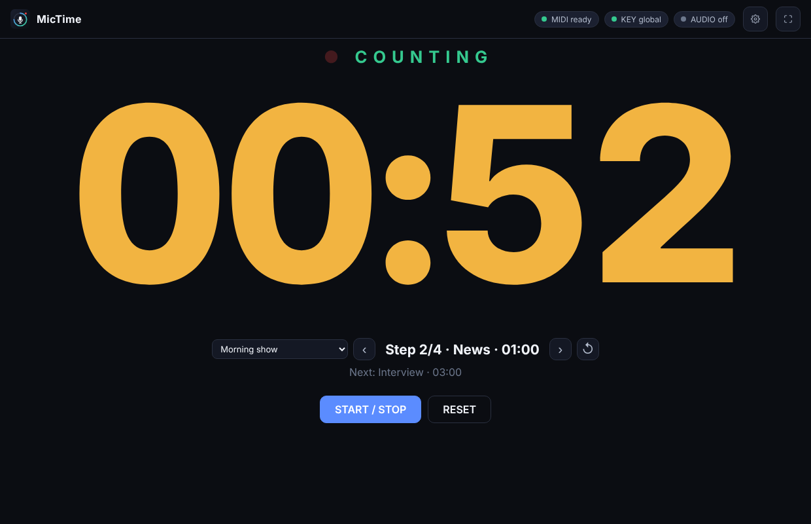
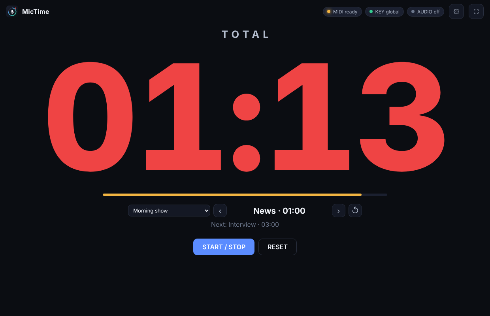
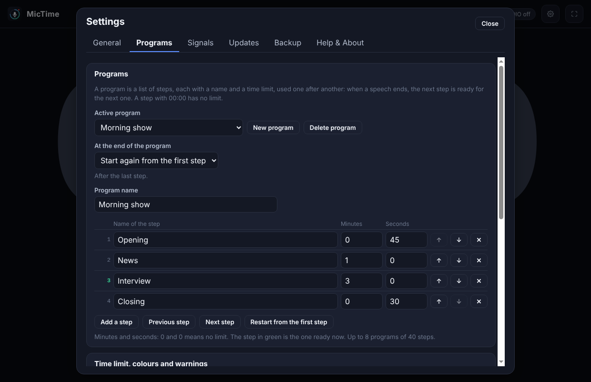
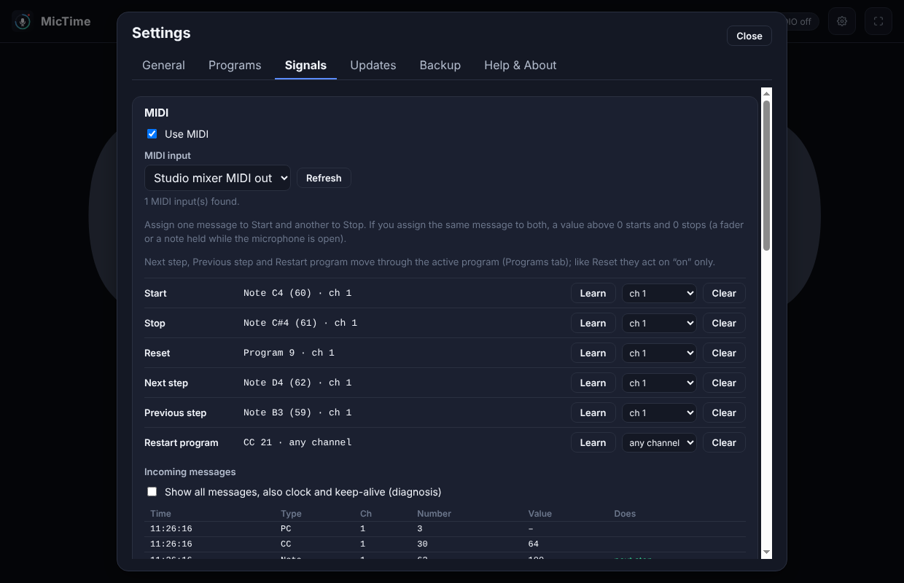

# MicTime

Free desktop app (Windows / macOS / Linux): a **talk timer for live radio and events**. The first signal starts the count, the next one stops it, the total stays on screen for a few seconds and the timer returns to zero. The signal can be a **MIDI message**, a **key** or the **level of an audio input**.

By Graziano Melzi · [OnAir Garage](https://onairgarage.com) — contact: hello@onairgarage.com



## Links

- Tool page: https://onairgarage.com/tools/mictime/ (when published)
- Author: Graziano Melzi · OnAir Garage · hello@onairgarage.com
- License: MIT (see `LICENSE`)
- Manual: [docs/MANUAL.md](docs/MANUAL.md) · MIDI specification: [docs/MIDI-SPEC.md](docs/MIDI-SPEC.md)
- Systems: Windows, macOS (Intel and Apple silicon), Linux (AppImage, x64). **What has been run:** the unit tests and an end-to-end run of the real app (Electron under Xvfb) on Linux x64; on **Windows** the installer of 0.1.0 was run by the author, with MIDI from virtual ports (loopMIDI, VMPK, MIDI-OX) and a global shortcut with another program in front. Not yet run on macOS, with real MIDI equipment, a real microphone or the new programs and colours on Windows (see "Not validated").

## What it does

- **Timer**: very large figures (`mm:ss`, `h:mm:ss` from one hour). Ready → counting → **total** (kept on screen for the time you set, 1–600 s, 5 by default, or until the next start with *never reset by itself*) → back to zero. A new start signal during the total begins a new count at once.
- **Time limits and programs**: a *program* is a list of steps, each with a name and a limit (for example Opening 00:45, News 01:00, Interview 03:00). After every speech the next step is armed by itself; at the end the program starts again or goes on without a limit. The step on screen and the next one are shown under the figures. Up to 8 programs of 40 steps, chosen from a menu or in Settings → Programs. Three more signals (**next step**, **previous step**, **restart program**) for when the running order changes. A step with 00:00 has no limit. With no program active, a **single time limit** (Settings → Programs) applies instead, with the same colours and warnings; 00:00 = no limit.
- **Colours**: the figures are grey at zero, change to a warning colour a few seconds before the limit (10 by default), to red when it is passed, and blink slowly (about once a second) when it is passed by a lot (10 s by default). The total keeps the colour it had at the stop. The four colours can be chosen. With "reduce motion" on in the system a steady red frame replaces the blinking.
- **Two ways to use the signals**: *one signal* (the same message or key starts and stops) or *two signals* (one starts, the other stops; or the same message with "on starts, off stops"). A separate **reset** signal returns to zero at once.
- **MIDI** (receive only): choose the input, assign start / stop / reset to a **note, a controller (CC) or a program change** with **MIDI learn**, any channel or one channel, and watch the incoming messages in a monitor. A value above 0 is *on*, 0 is *off*. Published specification with connection examples: [docs/MIDI-SPEC.md](docs/MIDI-SPEC.md).
- **Keyboard**: a key or combination you choose, as a **global shortcut** (works with another program in front, where the system allows it) or with the window in front. A global shortcut needs a modifier, an F key, a numpad key or a media key; the app says if the system refused it.
- **Audio level** (off by default): input, threshold and hold time. The count starts when the level reaches the threshold and stops after it stays below for the hold time. Only the level is measured; nothing is recorded, saved or sent, and the sound is not played.
- Repeated messages from a console (two for one press) are taken as one within a time you can change.
- Always on top, full screen (`F11`), the PC is kept from suspending while the app is open.
- **Languages**: English (default), Italiano, Español. **Theme**: dark (default), light, follow the system.
- **Backup** (Settings → Backup): export or import the MIDI mappings, the keys, the audio and timer settings, the programs, the colours, language and theme as `mictime-backup-YYYY-MM-DD.json`, with *Replace everything* or *Add only the missing*. The file holds no passwords or keys: the app uses none.
- **Guided update**: a strip offers *Download and install*, *Remind me later*, *Skip this version* and the release notes; progress bar; the installer is checked against `SHA256SUMS.txt`; *Close and install* makes a safety copy of the settings first; *What's new* shows once after an update. Nothing is installed without a click.
- **Help & About** (Settings): version, system, licence, credits, links, **Copy support info** (never your settings), **Open logs folder** (daily files, 5 MB at most, 7 days kept).

No alerts, no categories, no accounts: the app has nothing to send anywhere.





The screenshots use made-up data (a made-up device name, made-up message numbers, a clock moved forward).

## Privacy and network

MicTime contacts only `api.github.com` / `github.com`, to check for a new release (can be turned off in Settings → Updates). MIDI, keys and the audio level are read on this computer only. The window has no network access at all. No accounts, no analytics, no telemetry. The audio level needs the microphone permission of the system; the audio is never recorded or sent.

## Versions

Public releases are numbered `YY.M.N` (year, month, number: `26.10.1`). Betas are `0.N.P` (`0.1.0`, `0.2.0`…) and are published as GitHub pre-releases, so the update check never offers them; any public release is newer than every beta.

## Install

Download the installer for your system from the [Releases](https://github.com/djgragra/mictime/releases) page and check it against `SHA256SUMS.txt`. Installers: `MicTime-Setup-<V>.exe`, `MicTime-<V>-arm64.dmg`, `MicTime-<V>-x64.dmg`, `MicTime-<V>.AppImage`.

The app is free and **not code-signed**, so the first launch may show a warning:

- **macOS**: if you see "app is damaged" or "cannot be opened", right-click the app → *Open*, or run:
  ```bash
  xattr -dr com.apple.quarantine /Applications/MicTime.app
  ```
- **Windows**: if SmartScreen appears, click *More info* → *Run anyway*.
- **Linux**: `chmod +x MicTime-*.AppImage`, then run it.

## Rules the app follows, and their sources

| Value or rule | Source | Status |
|---|---|---|
| Note On velocity 0 = Note Off; value > 0 = on, 0 = off for notes and controllers; Program Change has no value | MIDI 1.0 channel messages (the Note On velocity-0 convention is part of MIDI 1.0) and the convention of this app, published in `docs/MIDI-SPEC.md` | recommended (the on/off rule is this app's convention, not part of MIDI) |
| Channels 1–16 shown, 0–15 on the wire; note 60 = C4 | MIDI 1.0, common naming | recommended; other devices name note 60 "C3" or "C5" |
| Audio level = RMS of a block of 1024 samples, in dBFS, silence = −100 dB | this app | not a standardised meter: it is a gate level, not a loudness or a true-peak reading |
| Counting uses the computer's monotonic clock; shown in whole seconds, rounded down | this app | by design |
| Colour of the figures: *warning* from `limit − warning time`, *over* above the limit (strictly: 01:00 on a 60 s limit is still *warning* until the count passes it), *blink* above `limit + blink time` | this app | by design: not a rule of any broadcaster; the times are yours to set |
| Behringer X32 sends MIDI when a scene is loaded; MB Studio MIDI | third-party forum threads / none found | **Dati insufficienti per verificare** (manufacturer manuals not read) |

## Assumptions and limits

- Not a certified instrument. The count starts and stops when the signal **arrives**; delays in a network, a driver or a virtual port are not compensated.
- A global shortcut is handled by the operating system. It may be refused (another program uses it) or not work at all on some Linux desktops (for example Wayland). The app reports a refusal and keeps the window-only key.
- MIDI is read through the Web MIDI API of the Electron window. If the system has no MIDI driver the indicator says so. System-exclusive messages are not used (Electron asks for the "midiSysex" permission for every Web MIDI request, so MicTime allows it; the page asks for no system-exclusive access and no code reads such messages).
- The audio gate does not tell speech from noise: it follows the level only.
- While the app is open the system is kept from suspending.

## Validation and references

| Reference | What it validates | Result | How to re-run |
|---|---|---|---|
| Unit tests (`dev/*.test.mjs`) | message parsing, learn, matching, the toggle / separate / gate rules, keys, the audio gate, the timer (hold, debounce, reset), settings validation, programs and colours, the limit colours and the steps, backup, logs, support info, the guided update with a fake GitHub (hash mismatch, interrupted download, `.part` cleanup, safety copy), the three languages, packaging rules | 68 tests, all pass (Linux, Node 22) | `npm test` |
| End-to-end run (`dev/e2e.mjs`) on the real app | start-up with ES modules, timer through the button, MIDI messages (injected into the real handler), learn, keys with the window in front, programs (steps, loop, free, debounce, remembered step), limit colours, the blinking and "reduce motion", "never reset", chosen colours, global shortcuts registered with the system (registration only), the audio gate with Chromium's fake audio device, settings tabs, language and theme | all checks pass on **Linux x64, Electron under Xvfb**. The packaged Linux build (`electron-builder --linux --dir`, code inside `app.asar`) was also started once and loaded its pages and modules | `npm ci && node dev/e2e.mjs` (needs `xvfb-run` or a display) |

## Not validated

- macOS: the interface, the installer, the first-launch warning, the microphone permission prompt. Windows: *Close and install* (does the new version start again after the installer, `runAfterFinish`?), the microphone, the programs and the colours.
- **Real MIDI**: on Windows MIDI arrived from virtual ports (loopMIDI with VMPK and MIDI-OX); a real console or controller was not used, and the input list on hot-plug is untested. On macOS and Linux nothing was received from MIDI at all.
- **Global shortcuts**: on Windows a real key press with another program in front worked (author's test); not tried on macOS, Linux X11 and Wayland.
- **Programs, limit colours and blinking** were checked in the real window on Linux only; the look on a real screen in a studio (contrast of the colours at a distance) is not judged.
- **Audio**: only Chromium's fake input device was used; no real microphone, no sound card.
- The X32 and MB Studio connection examples (see `docs/MIDI-SPEC.md`).
- The Spanish texts have not been read by a native speaker.

## Sources to re-check

| Document | Version read |
|---|---|
| Behringer X32 / X32 Rack manual and MIDI implementation | not read (third-party quotations only) |
| MB Studio manual | not found |
| MIDI 1.0 specification (MIDI Manufacturers Association) | not read |

## Run locally

```bash
npm ci
npm start          # the app
npm test           # unit tests
node dev/e2e.mjs   # end-to-end on the real app (Linux, xvfb-run or a display)
```

Icons: `PLAYWRIGHT_MODULE=… CHROMIUM=… node dev/make-icons.mjs` (from `assets/logo.svg`). Screenshots: `node dev/make-screenshots.mjs`.

## Structure

- `main.js`, `preload.cjs`: Electron main process (settings, global shortcuts, permissions, updates, backup) and the bridge.
- `src/trigger/`: **the signal code, independent of Electron** (`midi.js`, `keys.js`, `level.js`, `stopwatch.js`), shared with other OnAir Garage apps (header `garage-common: trigger 2`).
- `src/`: `limits.js` (colour states and the steps of a program), `schema.js` (settings), `backup.js`, `updater.js`, `logs.js`, `support.js`, `store.js`, `i18n.js`.
- `renderer/`: the interface (`signals.js` connects Web MIDI, keys and Web Audio to `src/trigger`).
- `dev/`: tests, end-to-end run, screenshot and icon generators. `docs/`: manual, MIDI specification, screenshots.

## Credits

Electron (MIT), electron-store (MIT). System fonts only; no third-party content is bundled. The idea comes from a radio presenter, Emanuele, who needed a talk timer next to a mixer and a playout program that can send MIDI.

## In italiano

**MicTime** è un cronometro per gli interventi in diretta (radio, eventi). Al primo segnale parte il conteggio, al successivo si ferma, il totale resta a schermo qualche secondo (configurabile, o finché non riparte) e poi il timer torna a zero. Con un **programma** (elenco di passi con tempo limite) ogni intervento ha il suo limite e il passo successivo si arma da solo; le cifre diventano gialle vicino al limite, rosse quando lo superi e lampeggiano lentamente se lo superi di molto. Il segnale può essere un **messaggio MIDI** (nota, controller o program change, con "impara"), un **tasto** (anche globale) o il **livello di un ingresso audio** (solo livello, niente registrazione). Due modalità: un solo segnale (avvia e ferma) o due segnali. Lingue: inglese, italiano, spagnolo. Backup delle impostazioni, aggiornamento guidato, nessun account né analisi. La specifica MIDI con gli esempi di collegamento è in [docs/MIDI-SPEC.md](docs/MIDI-SPEC.md). **Non ancora provato** su Windows, su Mac, con apparecchi MIDI veri e con un microfono vero: vedi "Not validated".
